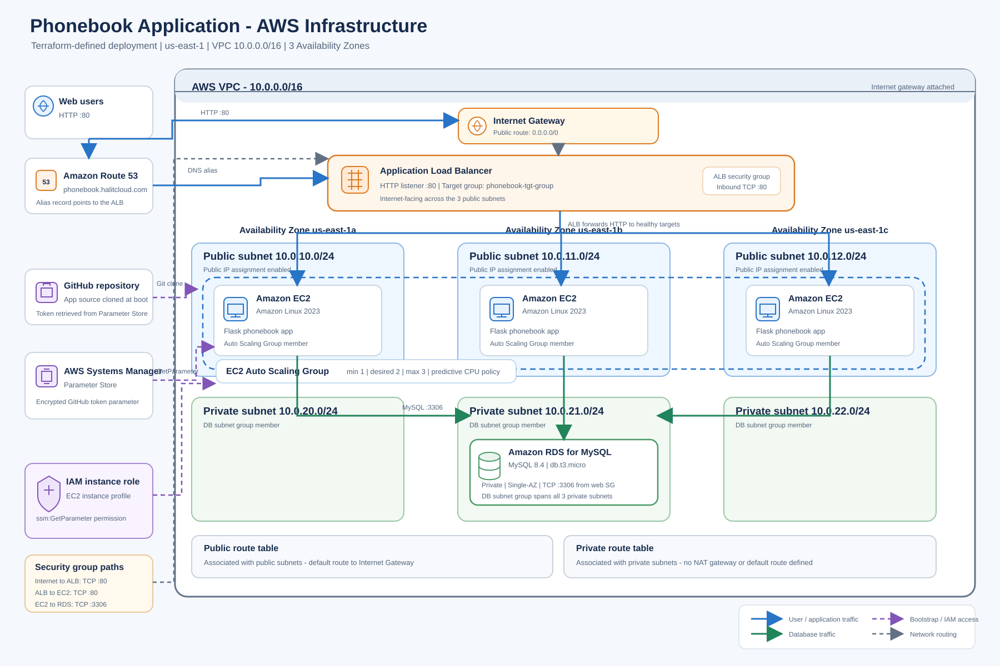
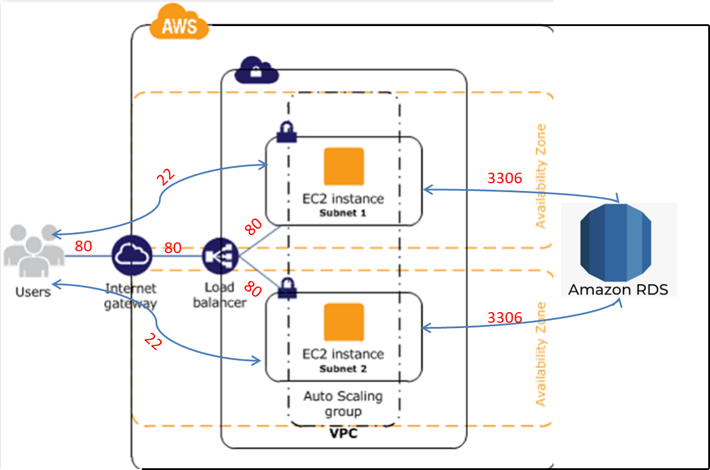
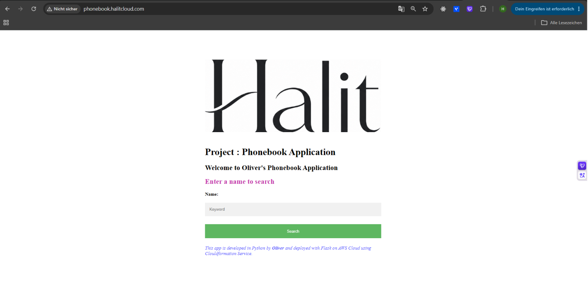

# Project: Phonebook Application (Python Flask) deployed on AWS Application Load Balancer with Auto Scaling and Relational Database Service using Terraform

## Description

The Phonebook Application aims to create a phonebook application in Python and deployed as a web application with Flask on AWS Application Load Balancer with Auto Scaling Group of Elastic Compute Cloud (EC2) Instances and Relational Database Service (RDS) using Terraform.

## Problem Statement



- Your company has recently started a project that aims to serve as phonebook web application. You and your colleagues have started to work on the project. Your teammates have developed the UI part the project as shown in the template folder and develop the coding part and they need your help to deploying the app in development environment.

- As a first step, you need to write program that creates a phonebook, adds requested contacts to the phonebook, finds and removes the contacts from the phonebook.

- Application should allow users to search, add, update and delete the phonebook records and the phonebook records should be kept in separate MySQL database in AWS RDS service. Following is the format of data to be kept in db.

  - id: unique identifier for the phone record, type is numeric.

  - person: full name of person for the phone record, type is string.

  - number: phone number of the person. type is numeric.

- All the interactions with user on phonebook app should be done in case insensitive manner and name of the person should be formatted so that, only the first letters of each words in the name of the person should be in capital letters. If the user inputs number in the username field, user should be warned with text message.

- Phone numbers in the app can be in any format, but the inputs should be checked to prevent string type. If the user inputs string in the number field, user should be warned with text message.

- Example for user inputs and respective formats

```text
Input in username field          Format to convert
--------------                   -----------------
''                               Warning -> 'Invalid input: Name can not be empty'
callahan                         Callahan
joHn doE                         John Doe
62267                            Warning -> 'Invalid input: Name of person should be text'

Input in number field            Format to convert
--------------                   -----------------
''                               Warning -> 'Invalid input: Phone number can not be empty'
1234567890                       1234567890
546347                           546347
thousand                         Warning -> 'Invalid input: Phone number should be in numeric format'
```

- As a second step, after you finish the coding, you are requested to deploy your web application using Python's Flask framework.

- You need to transform your program into web application using the `index.html`, `add-update.html` and `delete.html` within the `templates` folder. Note the followings for your web application.

  - User should face first with `index.html` when web app started and the user should be able to; 

    - search the phonebook using `index.html`.

    - add or update a record using `add-update.html`.

    - delete a record using `delete.html`.

  - User input can be either integer or string, thus the input should be checked for the followings,

    - The input for name should be string, and input for the phone number should be decimal number.

    - When adding, updating or deleting a record, inputs can not be empty.

    - If the input is not conforming with any conditions above, user should be warned using the `index.html` with template formatting.

  - The Web Application should be accessible via web browser from anywhere.

- Lastly, after transforming your code into web application, you are requested to push your program to the project repository on the Github and deploy your solution in the development environment on AWS Cloud using Terraform to showcase your project. In the development environment, you can configure your Terraform file using the followings,



  - The Terraform configuration creates a dedicated VPC with CIDR `10.0.0.0/16` across three Availability Zones in `us-east-1`; it does not use the default VPC.

  - Each Availability Zone has a public subnet (`10.0.10.0/24` through `10.0.12.0/24`) and a private subnet (`10.0.20.0/24` through `10.0.22.0/24`). Public subnets route internet traffic through an Internet Gateway. The private route table has no default route, and no NAT Gateway is configured.

  - The internet-facing Application Load Balancer spans the public subnets. Its security group allows HTTP (TCP 80) from anywhere and forwards requests to the EC2 target group.

  - The Auto Scaling Group runs EC2 instances in the public subnets. The web security group allows HTTP (TCP 80) from the ALB security group and SSH (TCP 22) from anywhere; restrict SSH ingress to trusted addresses before using this configuration in a production environment.

  - The Auto Scaling Group uses a Launch Template and is configured with desired capacity `2`, minimum size `1`, maximum size `3`, a `300`-second health check grace period, and `ELB` health checks. A predictive scaling policy targets 70% CPU utilization.

  - The Launch Template selects the latest matching Amazon Linux 2023 x86_64 AMI, uses instance type `t3.small`, installs Python and Flask dependencies, retrieves the GitHub token from Systems Manager Parameter Store using an EC2 IAM role, clones this repository, and starts the Flask application.

  - RDS runs MySQL `8.4` on `db.t3.micro`. The database is not publicly accessible and uses a DB subnet group containing the three private subnets. It is configured as a single-AZ instance. The database security group allows MySQL (TCP 3306) only from the web security group.

  - Route 53 creates the `phonebook.halitcloud.com` alias record (using the `hosted_zone_name` variable) pointing to the ALB. Terraform outputs the website URL and the ALB URL; both use HTTP.

## Project Skeleton 

```text
phonebook-application-aws-deployment-using-terraform (folder)
|
|----README.md
|----vpc_subnets.tf          # VPC, public/private subnets and DB subnet group
|----igw.tf                 # Internet Gateway
|----route_table.tf         # Public/private route tables and subnet associations
|----alb.tf                 # Application Load Balancer and listener
|----targetgroup.tf         # ALB target group
|----auto_scaling_group.tf  # Auto Scaling Group, scaling policy and target attachment
|----launch_template.tf     # EC2 launch template and application bootstrap
|----rds.tf                 # MySQL RDS instance
|----sec-grp.tf             # ALB, web and database security groups
|----iam_role_policy.tf     # EC2 role, policy and instance profile
|----route53_record.tf      # Route 53 alias record
|----data.tf                # AMI, account identity and hosted zone lookups
|----variables.tf
|----output.tf
|----version.tf
|----phonebook-app.py        # Given to the students (Python Flask Web Application)
|----templates
        |----index.html      # Given to the students (HTML template)
        |----add-update.html # Given to the students (HTML template)
        |----delete.html     # Given to the students (HTML template)
```

## Expected Outcome



### At the end of the project, following topics are to be covered;

- Algorithm design

- Programming with Python

- Programming with SQL

- Web application programming with Python Flask Framework

- MySQL Database Configuration

- Bash scripting

- AWS EC2 Launch Template Configuration

- AWS EC2 Application Load Balancer Configuration

- AWS EC2 ALB Target Group Configuration

- AWS EC2 ALB Listener Configuration

- AWS EC2 Auto Scaling Group Configuration

- AWS Relational Database Service Configuration

- AWS EC2 Security Groups Configuration

- Terraform Configuration with AWS

- Terraform Configuration with Github

- Git & Github for Version Control System

### At the end of the project, students will be able to;

- show their coding skills using boolean/math operators, string formatting, if statements and functions within Python.

- apply web programming skills using HTTP GET/POST methods, template formatting, importing packages within Python Flask Framework

- configure connection to the `MySQL` database.

- work with a database using the SQL within Flask application.

- demonstrate bash scripting skills using `user data` section within launch template in Terraform to install and setup web application on EC2 Instance.

- demonstrate their configuration skills of AWS EC2 Launch Templates, Application Load Balancer, ALB Target Group, ALB Listener, Auto Scaling Group, RDS and Security Groups.

- configure Terraform template to use AWS Resources.

- show how to use Terraform to launch AWS Resources.

- apply git commands (push, pull, commit, add etc.) and Github as Version Control System.

## Steps to Solution
  
- Step 1: Download or clone project definition from repo on Github 

- Step 2: Create project folder for local public repo on your pc

- Step 3: Write the Phonebook Application in Python

- Step 4: Transform your application into web application using Python Flask framework

- Step 5: Prepare a Terraform template to deploy your app on Application Load Balancer together with RDS

- Step 6: Initialize Terraform in your current folder.

- Step 7: Run terraform commands (`terraform plan` and `terraform apply`) to deploy your application on AWS Cloud using Terraform template to showcase your app.

- Step 6: Run `terraform destroy` command to destroy resources that you created with terraform.


## Notes

- Use the template formatting library `jinja` within Flask framework to leverage from given templates.

- Use given html templates to warn user with invalid inputs.

- Customize the application by hard-coding your name for the `developer_name` variable within html templates.

- The VPC, subnets, route tables, and security groups are created and managed by the Terraform files in this repository; the deployment does not require subnet IDs from a default VPC.

## Resources

- [Python Flask Framework](https://flask.palletsprojects.com/en/1.1.x/quickstart/)

- [Python Flask Example](https://realpython.com/flask-by-example-part-1-project-setup/)

- [Terraform AWS Provider Documentaion](https://registry.terraform.io/providers/hashicorp/aws/latest/docs)

- [AWS CLI Command Reference](https://docs.aws.amazon.com/cli/latest/index.html)
